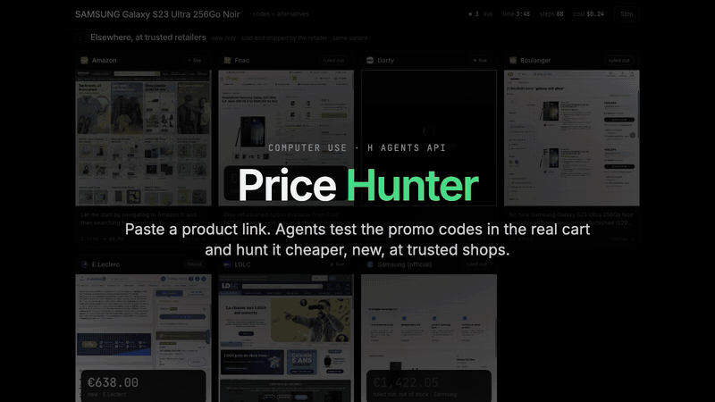
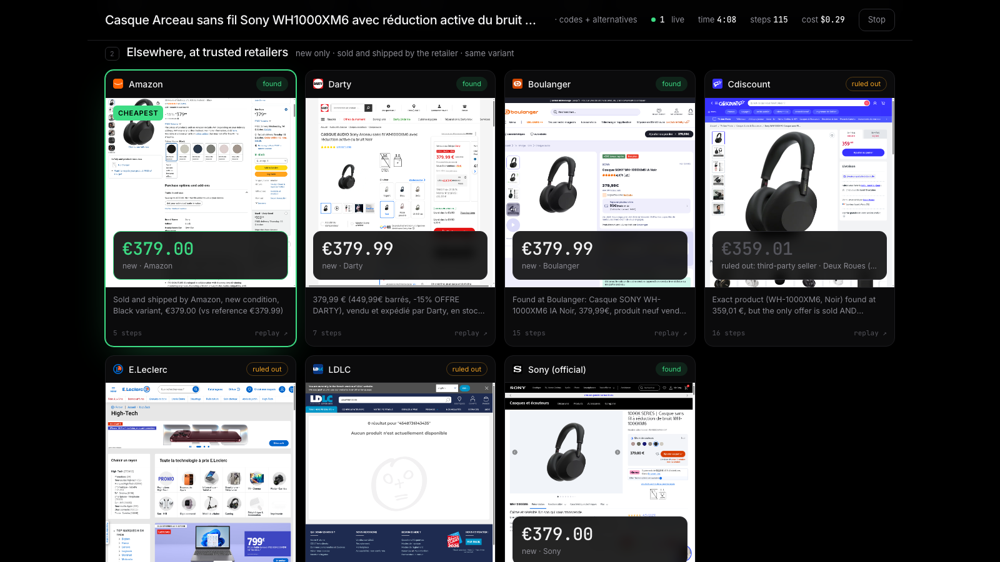
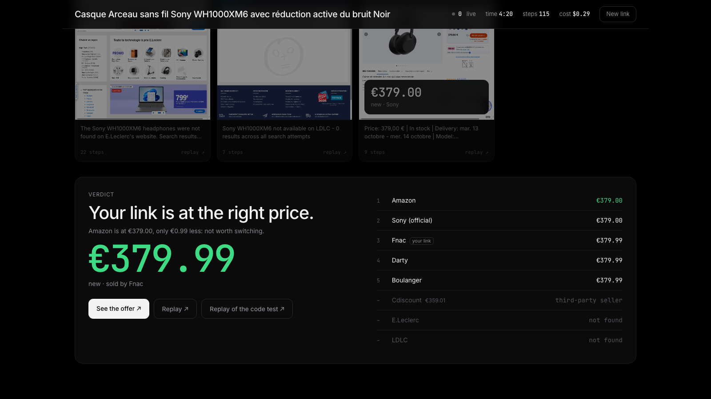

# price hunter

paste a product link. H web agents read the page, find promo codes for that shop and **try them in the cart**, and look for the same product, new, at trusted retailers. you watch every browser live, then get one answer: where to buy, and with which code.



## why

most promo codes you find online don't work once you type them. and the cheapest price on a comparison site is often a marketplace seller, a refurbished unit or another color. so the agents do what you would do by hand, in parallel:

1. **read your link.** brand, exact model, variant (color, capacity), EAN, price, condition, seller.
2. **test the codes.** one agent picks the codes still valid on Dealabs for that shop, adds the product to the cart and types them one by one. a code only counts if the cart accepts it, and the saving is read from the cart total, not from the ad.
3. **check trusted shops.** Amazon, Fnac, Darty, Boulanger, Cdiscount, E.Leclerc, LDLC and the brand's own store, each in its own browser. an offer is kept only if it's the same variant, new, in stock, and sold and shipped by the shop itself. marketplace sellers are shown but ruled out, with the reason.
4. **verdict.** if another shop beats your link by more than 1%, its codes get tried too. then you get the best safe price, the code to copy and a replay link for every agent.

the agents never log in and never go past the cart. nothing is ever bought.





## run it

you need an H API key: https://platform.hcompany.ai/settings/api-keys

```bash
cp .env.example .env   # put your HAI_API_KEY in it
uv run server.py
```

open http://127.0.0.1:8765 and paste a product link from a French shop.

## how it's built

- `server.py`: FastAPI. each agent is one session on the Agents API (`h/web-surfer-flash`) with a JSON schema as `agent.answer_format`, so answers come back structured (product, offer, codes tried). a thread per session long-polls `get_session_changes` and keeps the latest screenshot, thought, click position, steps and cost. slow agents get `force_session_answer` after a deadline so the hunt always ends.
- `web/index.html`: one page, no build. it reads a server-sent event stream and paints a tile per agent: live screenshot, cursor where it clicked, what it's thinking, then the price or the codes it tried.
- the safety filter (same variant, new, sold by the shop, in stock) runs on the server, not in the prompt only.

## numbers

a full hunt is 9 or 10 agents and takes 4 to 8 minutes, depending on how many sessions your org can run at once (the rest wait in the queue). it costs $0.30 to $0.40.

## limits

- French retailers only for now (the list lives in `SHOPS` in `server.py`).
- some carts only show the promo field once you're logged in. the agent reports "login needed" instead of logging in.
- if Dealabs has nothing for that shop, there's nothing to try.
